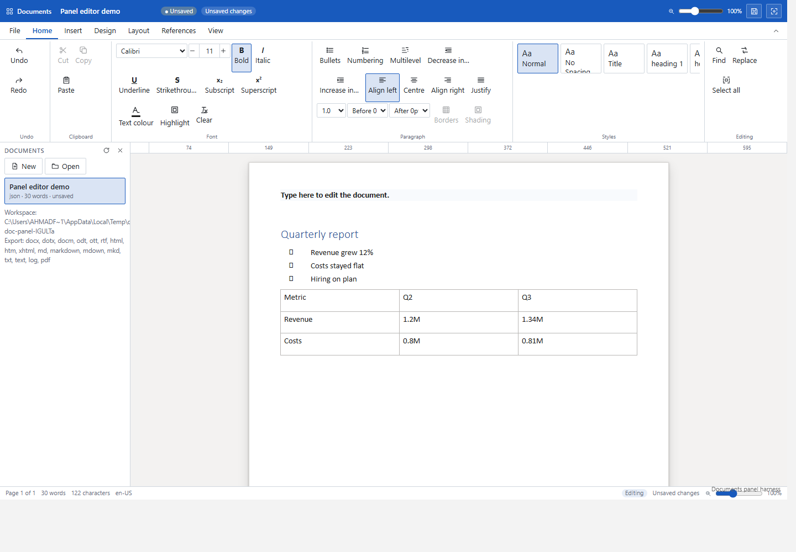
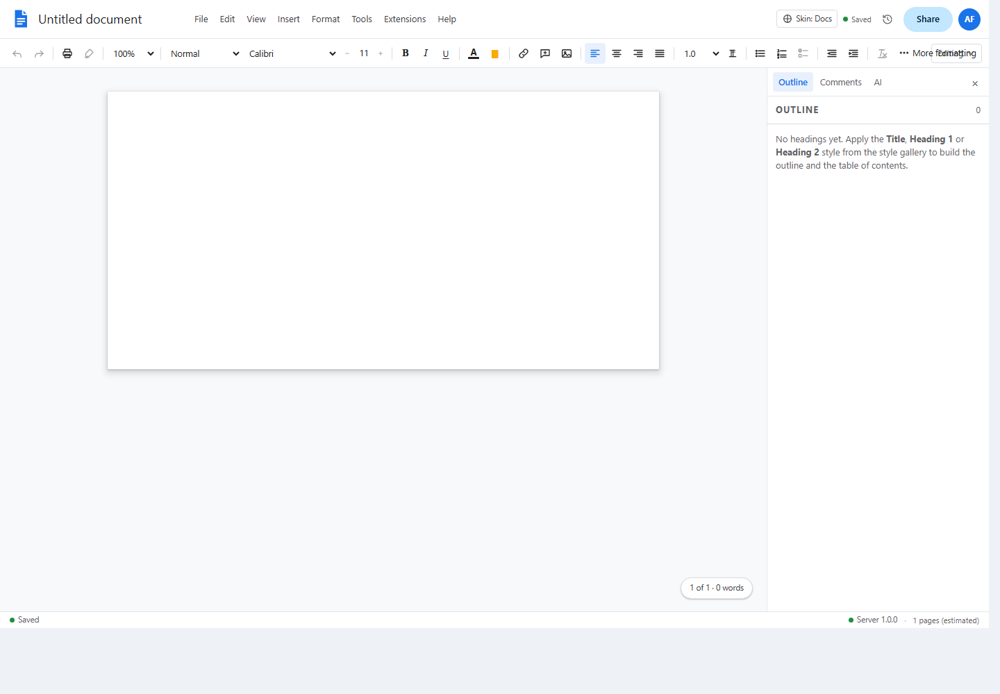
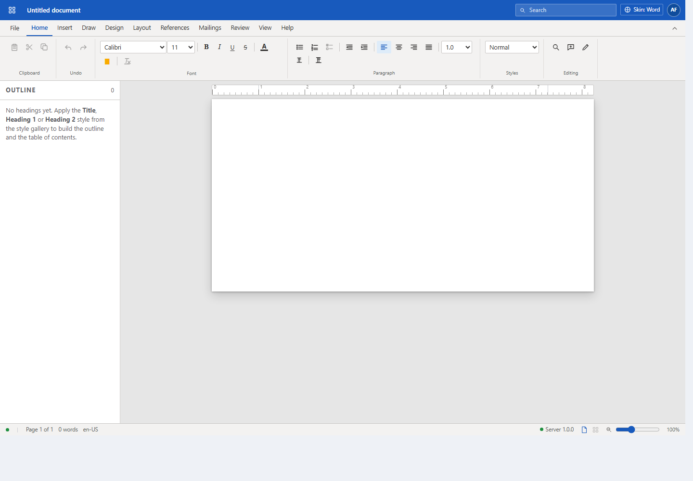
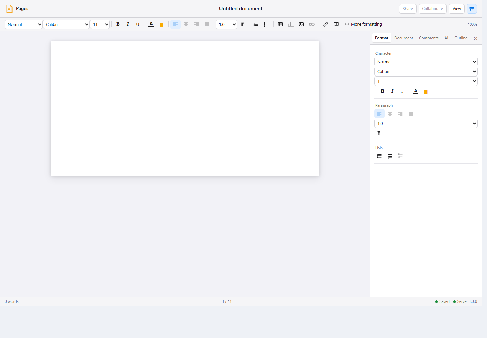
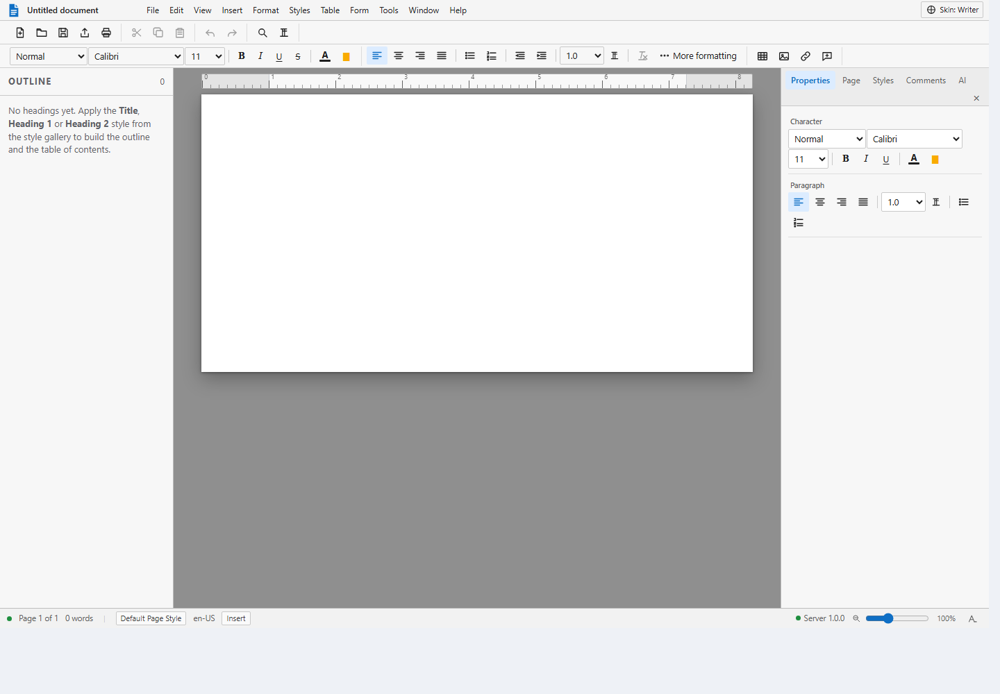

# DSH Document Engine (`dsh-doc-editor`)

A universal document platform: a Word/Google-Docs-style editor, an independent
layout and rendering engine, a conversion engine, and a programmable document
service exposed through MCP, native agent tools and reusable skills.

The whole platform operates on **one versioned, format-independent document
model**. The editor, renderer, converter, AI assistant and MCP server are all
clients of that model — there is no second parser, no HTML-only shortcut and no
duplicated business logic.

```
┌────────────┐  ┌────────────┐  ┌────────────┐  ┌────────────┐
│  Editor UI │  │ MCP server │  │ Agent tools│  │    CLI     │
└─────┬──────┘  └─────┬──────┘  └─────┬──────┘  └─────┬──────┘
      └───────────────┴───────────────┴───────────────┘
                      │  DocumentService (single API)
      ┌───────────────┼───────────────┬───────────────┐
┌─────▼──────┐ ┌──────▼──────┐ ┌──────▼──────┐ ┌──────▼──────┐
│ Document   │ │ Layout      │ │ Conversion  │ │ AI assistant│
│ model+ops  │ │ engine      │ │ engine      │ │ (providers) │
└─────┬──────┘ └──────┬──────┘ └──────┬──────┘ └─────────────┘
      │               │               │
┌─────▼──────┐ ┌──────▼──────┐ ┌──────▼──────┐
│ OOXML      │ │ HTML / SVG  │ │ HTML, MD,   │
│ DOCX import│ │ PDF         │ │ TXT, RTF,   │
│ / export   │ │ renderers   │ │ ODT adapters│
└────────────┘ └─────────────┘ └─────────────┘
```

## Quick start

Requirements: **Node.js ≥ 22** and **pnpm** (the repository pins
`packageManager: pnpm@11.28.5`).

```bash
pnpm install
pnpm run build          # core library, MCP server, CLI, web editor
pnpm test               # unit + integration + fixture + MCP protocol tests
```

### Editor

```bash
pnpm run web:dev        # Vite dev server (http://127.0.0.1:5173, proxies /api to :4317)
# or, after a build:
pnpm run web:start      # serves the built UI + HTTP API on :4317 (PORT overrides)
```

The editor is model-first: typing, formatting, lists, tables, images, comments
and AI applications are all translated into deterministic document operations,
so undo, auditing and import/export see exactly the same document.

### MCP server (stdio)

```bash
pnpm run mcp:start
# equivalent: node apps/mcp/dist/main.js
```

Add it to an MCP client:

```json
{
  "mcpServers": {
    "dsh-doc": {
      "command": "node",
      "args": ["/absolute/path/to/dsh-doc-editor/apps/mcp/dist/main.js"],
      "env": {
        "DSH_DOC_WORKSPACE": "/absolute/path/to/document-workspace"
      }
    }
  }
}
```

### CLI

```bash
node apps/cli/dist/main.js info fixtures/docx_docs_renderer_feature_test_cases.docx
node apps/cli/dist/main.js render fixtures/docx_docs_renderer_feature_test_cases.docx --format pdf --out out/fixture.pdf
node apps/cli/dist/main.js verify fixtures/docx_docs_renderer_feature_test_cases.docx
node apps/cli/dist/main.js roundtrip fixtures/docx_docs_renderer_feature_test_cases.docx
```

## Install as an agent plugin (no build)

### DeepSeek Harness

Paste this into **Plugins → Add plugin** (verified on DSH `0.2.2-rc.3`):

```text
https://github.com/ahmadfarizoffice-dotcom/dsh-doc-editor-plugin
```

The bundle is self-contained (the engine is inlined, no dependencies, no install
scripts) and adds a **Documents panel** — a real Word-like editor with the seven
tabs **File · Home · Insert · Design · Layout · References · View**, an editable
page, and 26 `document_*` tools. Agent equivalent:

```text
plugin_manager action: install_bundle target: github:ahmadfarizoffice-dotcom/dsh-doc-editor-plugin
```



After installing or updating the bundle, reload the Harness page (and restart
the runtime if the panel still shows the previous version) so the browser loads
the new client module.

Source: [`dsh-plugin/`](dsh-plugin) in this repository; published from
[dsh-doc-editor-plugin](https://github.com/ahmadfarizoffice-dotcom/dsh-doc-editor-plugin).

### Claude Code

```text
/plugin marketplace add ahmadfarizoffice-dotcom/dsh-doc-editor
/plugin install dsh-doc@dsh-doc
```

The plugin lives in [`integrations/claude-code`](integrations/claude-code)
(MCP server launch, the 12 skills, and slash commands). A plain `.mcp.json` is
included for projects that do not use plugins.

### Codex CLI, Google Antigravity, OpenCode

Ready-made configs and installers live in [`integrations/`](integrations):
`codex/config.toml` plus an idempotent `install.mjs`, `antigravity/mcp_config.json`,
and `opencode/opencode.json` with an optional 3-tool plugin. All of them launch
the same MCP server; see [INSTALL.md](INSTALL.md) for exact paths and the
absolute-path placeholders you must fill in.

### Standalone editor

`pnpm run web:start` serves the editor at `http://127.0.0.1:4317`.

#### Editor skins

The same document, selection and undo history render under four faithful
chrome styles; the skin is presentation only and never touches the model:

| Skin                               | What it reproduces                                                                                                                                   |
| ---------------------------------- | ---------------------------------------------------------------------------------------------------------------------------------------------------- |
| **Google Docs** (`gdocs`, default) | white app bar with document glyph and File/Edit/View menus, compact formatting bar, share pill and avatar, blue-gray canvas, floating page/word pill |
| **Microsoft Word** (`word`)        | blue title bar with search, ribbon tabs and labelled groups, ruler, gray workspace, status bar with page/word count, language, zoom and view icons   |
| **Apple Pages** (`pages`)          | light top bar with centred inline title, slim toolbar, Format inspector, warm canvas, page indicator                                                 |
| **LibreOffice Writer** (`writer`)  | menu bar, standard + formatting toolbars, gray canvas with ruler, sidebar deck, status bar with page style and insert mode                           |

Switch skins from the skin menu in each app bar; the choice persists in
`localStorage` (`dsh-doc:skin`). `?skin=word` (or `pages`, `writer`, `gdocs`)
overrides it for a session without persisting. Controls whose backend is not
implemented are rendered disabled with an explanation rather than as dead
buttons.

| Google Docs                                     | Microsoft Word                                          |
| ----------------------------------------------- | ------------------------------------------------------- |
|  |        |
| **Apple Pages**                                 | **LibreOffice Writer**                                  |
|  |  |

## The golden fixture

`fixtures/docx_docs_renderer_feature_test_cases.docx` (the supplied acceptance
fixture) is part of the test suite:

```bash
pnpm run test:fixture   # import, structure, layout/pagination, render, round-trip
```

Current result on the fixture: **3 sections** (Letter portrait, A4 landscape,
A4 portrait), **310 paragraphs**, **5 tables**, header/footer on every section,
page-number field resolved, 8 rendered pages, and a **byte-identical text
round-trip** through `DOCX → model → DOCX → model`.

The fixture's written checklist covers more cases than the file physically
contains (it describes images, footnotes, comments, tracked changes, equations
and text boxes but embeds none of them). We therefore also ship an **extended
fixture** generated from real OOXML that adds those constructs — see
[TESTING.md](TESTING.md#the-fixture-family).

## What is implemented

| Area                                                                                                                             | Status                                               |
| -------------------------------------------------------------------------------------------------------------------------------- | ---------------------------------------------------- |
| DOCX / DOTX / DOCM import + export (round-trip)                                                                                  | ✅ implemented, fixture-verified                     |
| Shared document model with versioning, unknown-element preservation                                                              | ✅                                                   |
| Deterministic editing operations (text, formatting, lists, tables, sections, images, notes, comments, revisions, TOC, equations) | ✅                                                   |
| Layout engine (pagination, line breaking, tables, floats, headers/footers, footnotes, columns)                                   | ✅                                                   |
| HTML, SVG and PDF renderers over the layout model                                                                                | ✅                                                   |
| Conversion engine with capability matrix and loss reports                                                                        | ✅ (adapters vary — see matrix)                      |
| MCP server: 50 tools, 8 resources, 8 prompts, typed schemas                                                                      | ✅                                                   |
| Native agent tool definitions (JSON Schema)                                                                                      | ✅                                                   |
| Reusable skills (12)                                                                                                             | ✅                                                   |
| Editor UI (formatting, tables, images, comments, find/replace, outline, AI panel, print preview)                                 | ✅                                                   |
| AI assistant (Ask / Suggest / Edit), provider independent                                                                        | ✅ with provider caveats                             |
| PDF **import**                                                                                                                   | ❌ not supported (documented)                        |
| Google Drive / Google Docs API integration                                                                                       | ❌ not implemented (DOCX/HTML interoperability only) |
| Macro execution, script execution, external entity resolution                                                                    | ❌ never performed (by design)                       |

Full detail: [FEATURES.md](FEATURES.md) · [SUPPORTED_FORMATS.md](SUPPORTED_FORMATS.md) · [ARCHITECTURE.md](ARCHITECTURE.md).

## Repository layout

```
packages/core/src/
  model/     versioned document model + deterministic operations
  docx/      OOXML import/export (DOCX, DOTX, DOCM)
  formats/   HTML, Markdown, TXT, RTF, ODT, legacy DOC, Apple Pages, XLSX/PPTX preview
  layout/    pagination and line/table/float layout (font metrics included)
  render/    HTML, SVG, PDF renderers
  convert/   conversion engine: capability matrix, fidelity, loss reports
  service/   workspace, sessions, history, auditing, the unified API
  ai/        provider independent assistant (openai-compatible, ollama, offline)
  tools/     tool/resource/prompt registry shared by MCP and agents
apps/
  web/       editor UI (React + Vite) and HTTP API server
  mcp/       Model Context Protocol server (stdio)
  cli/       `dsh-doc` command line interface
dsh-plugin/  DeepSeek Harness bundle (Host tools + Documents panel + client half)
integrations/ Claude Code, Codex, Antigravity and OpenCode packages
skills/      12 agent skills with routing and safety guidance
fixtures/    golden DOCX fixtures and the extended acceptance fixture
test/        fixture, render and round-trip acceptance tests
```

## Documentation

- [INSTALL.md](INSTALL.md) — plugin install for DSH, Claude Code, Codex, Antigravity, OpenCode and the standalone editor
- [ARCHITECTURE.md](ARCHITECTURE.md) — components, data flow, invariants, decisions
- [FEATURES.md](FEATURES.md) — implemented feature inventory and honest status
- [SUPPORTED_FORMATS.md](SUPPORTED_FORMATS.md) — import/export matrix and fidelity notes
- [MCP.md](MCP.md) — tools, resources, prompts, security, configuration
- [AGENT_SKILLS.md](AGENT_SKILLS.md) — skills inventory, routing, integration
- [TESTING.md](TESTING.md) — fixture procedure, test suite, CI, regression policy
- [AGENTS.md](AGENTS.md) — short agent-facing entry point
- [CONTRIBUTING.md](CONTRIBUTING.md) — workflow, adding adapters/tools/skills
- [SECURITY.md](SECURITY.md) — threat model and reporting

## Configuration

Copy `.env.example` to `.env` and adjust. Nothing sensitive is committed.

| Variable                            | Purpose                                           |
| ----------------------------------- | ------------------------------------------------- |
| `DSH_DOC_WORKSPACE`                 | Workspace root for documents and audit log        |
| `DSH_DOC_READ_ONLY`                 | `1` disables all mutations                        |
| `DSH_DOC_AUDIT_LOG`                 | Audit log path (JSON Lines)                       |
| `DSH_DOC_ALLOWED_ROOTS`             | Extra readable roots (path-delimited)             |
| `DSH_DOC_AI_PROVIDER`               | `offline` \| `openai` \| `ollama` (default: auto) |
| `DSH_DOC_AI_MODEL`                  | Model id for the selected provider                |
| `OPENAI_API_KEY`, `OPENAI_BASE_URL` | OpenAI-compatible endpoint                        |
| `OLLAMA_HOST`                       | Local Ollama endpoint                             |
| `PORT`                              | Web server port                                   |

## License

MIT — see [LICENSE](LICENSE).
